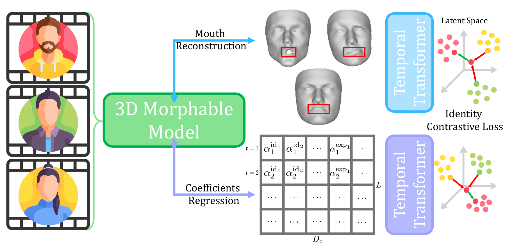

# MOTIF: Person-of-Interest Deepfake Detection Beyond 3DMM Coefficients

[](https://arxiv.org/abs/2610.09830)
[](https://huggingface.co/heyGio/MOTIF)

by [Giovanni Affatato](https://heygio.github.io/), Sara Mandelli, Paolo Bestagini, and Stefano Tubaro.

This repository is the official inference implementation of **MOTIF**, accepted at the 2026 IEEE International Workshop on Information Forensics and Security (WIFS). Read the paper on [arXiv](https://arxiv.org/abs/2610.09830).

## Method

<p align="center"></p>

MOTIF is a visual person-of-interest deepfake detector. It enrolls a subject from genuine reference videos and scores a query video without retraining. The released detector uses two independently trained temporal transformers:

- a **global branch** over per-frame 3D morphable-model shape, expression, pose, and translation coefficients;
- a **mouth branch** over temporally centered 3D lip-vertex motion reconstructed from the same fit.

Both branches analyze 75-frame windows with 50% overlap. They compare query and reference embeddings using person-specific normalization and cosine similarity. The final score averages the two calibrated branch scores; higher values indicate greater consistency with the enrolled person.

## Install

MOTIF requires **an NVIDIA GPU and Python 3.10 or newer**. Video decoding uses
PyAV's bundled FFmpeg libraries.

```bash
python -m pip install git+https://github.com/polimi-ispl/MOTIF
```

The first run downloads the two MOTIF checkpoints, normalization statistics, and upstream 3DDFA-V3 face-analysis assets. All files are cached by Hugging Face.

## Score a video

Use independent clips containing one clearly visible person. Ten reference videos match the paper protocol; at least two usable reference videos and enough valid reference windows are required for leave-one-out calibration.

```bash
motif score \
  --reference genuine1.mp4 genuine2.mp4 genuine3.mp4 \
  --test query.mp4
```

For repeated use, extract the reference set once:

```bash
motif extract-reference \
  --reference genuine1.mp4 genuine2.mp4 genuine3.mp4 \
  --output person.npz

motif score --reference-set person.npz --test query.mp4
```

Or keep the models loaded in Python:

```python
from motif import MotifPipeline

pipeline = MotifPipeline()
reference = pipeline.extract_reference_set(
    ["genuine1.mp4", "genuine2.mp4", "genuine3.mp4"]
)
result = pipeline.score(reference, "query.mp4")
print(result["score"])
```

The score is not a probability and does not define a universal real/fake threshold. Calibrate an operating threshold on separate validation data representative of the intended use.

## Weights and licenses

| Required file | Source |
| --- | --- |
| `motif_global.pth` | [MOTIF](https://huggingface.co/heyGio/MOTIF) |
| `motif_mouth.pth` | [MOTIF](https://huggingface.co/heyGio/MOTIF) |
| `norm_stats_all.npz` | [MOTIF](https://huggingface.co/heyGio/MOTIF) |
| `norm_stats_mvrecon.npz` | [MOTIF](https://huggingface.co/heyGio/MOTIF) |
| `retinaface_resnet50_2020-07-20_old_torch.pth` | RetinaFace via the [3DDFA-V3 Hub repository](https://huggingface.co/datasets/Zidu-Wang/3DDFA-V3) |
| `large_base_net.pth` | HRN via the 3DDFA-V3 Hub repository |
| `net_recon.pth` | 3DDFA-V3 via the 3DDFA-V3 Hub repository |

Only load trusted checkpoints and reference sets. MOTIF code is [MIT licensed](LICENSE); vendored 3DDFA-V3 code retains its own notice. Third-party model assets retain their respective terms.

## Acknowledgements

Our implementation builds on code and model assets from [3DDFA-V3](https://github.com/wang-zidu/3DDFA-V3), [Deep3D](https://github.com/microsoft/Deep3DFaceReconstruction), [HRN](https://github.com/youngLBW/HRN), and [RetinaFace](https://github.com/biubug6/Pytorch_Retinaface). We thank their authors for making these resources available.

## Citation

```bibtex
@inproceedings{affatato2026motif,
  title = {{MOTIF}: Person-of-Interest Deepfake Detection Beyond {3DMM} Coefficients},
  author = {Affatato, Giovanni and Mandelli, Sara and Bestagini, Paolo and Tubaro, Stefano},
  booktitle = {2026 IEEE International Workshop on Information Forensics and Security (WIFS)},
  year = {2026},
  eprint = {2610.09830},
  archivePrefix = {arXiv},
  primaryClass = {cs.CV},
  url = {https://arxiv.org/abs/2610.09830}
}
```
